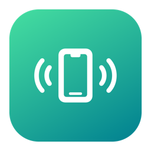
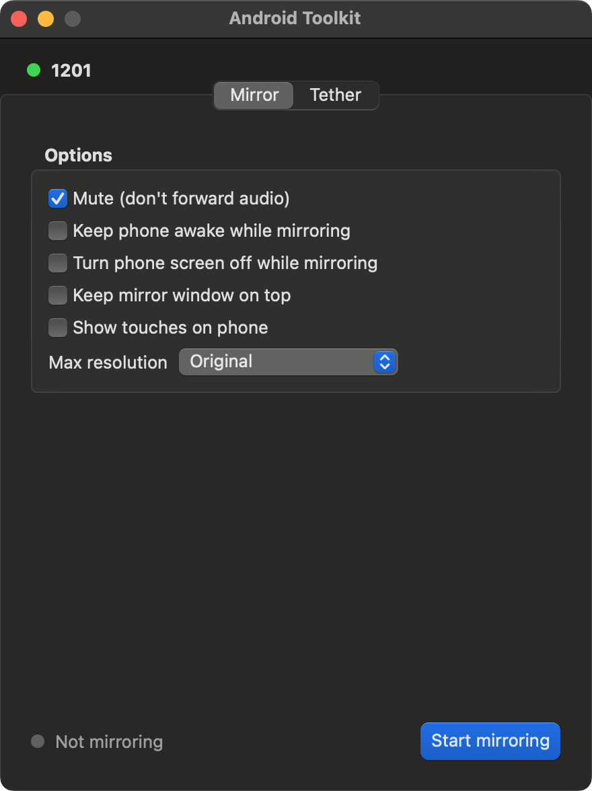

<p align="center"></p>

<h1 align="center">Android Toolkit for Mac</h1>

<p align="center">A small SwiftUI app that mirrors your Android screen with scrcpy and shares its internet over USB tethering, with one click each.</p>

<p align="center"></p>

## What it does

- **Mirror tab**: starts [scrcpy](https://github.com/Genymobile/scrcpy) with the options you tick: mute audio, keep the phone awake, turn its screen off, keep the window on top, show touches, cap the resolution.
- **Tether tab**: starts and stops USB tethering through [TetherKit](https://github.com/XiaoMiku01/TetherKit), a user-space RNDIS driver, then brings the interface up with DHCP. Includes a "Test internet" button and a driver log.
- Shows the connected phone and its state at the top.

## Why

[HoRNDIS](https://github.com/jwise/HoRNDIS), the classic Android USB tethering driver for macOS, is a kernel extension and no longer loads on recent macOS. TetherKit does the same job in user space (libusb plus a `feth` interface), so no kext and no SIP changes. This app is the front end that makes it a button.

## Requirements

- macOS 12 or newer (built and tested on macOS 12.7 Intel)
- [scrcpy](https://github.com/Genymobile/scrcpy) and `adb` on your PATH (`/opt/local/bin`, `/usr/local/bin`, or system paths are searched)
- An Android phone with USB debugging on (for mirroring) and USB tethering available
- The `tetherkit-cli` binary (for tethering), see below

## Build the app

```sh
mkdir -p "Android Toolkit.app/Contents/MacOS" "Android Toolkit.app/Contents/Resources"
cp Info.plist "Android Toolkit.app/Contents/Info.plist"
cp AppIcon.icns "Android Toolkit.app/Contents/Resources/"
swiftc -parse-as-library -O -target x86_64-apple-macos12.0 \
  -o "Android Toolkit.app/Contents/MacOS/AndroidToolkit" AndroidToolkit.swift
codesign --force --deep -s - "Android Toolkit.app"
cp -R "Android Toolkit.app" /Applications/
```

On Apple Silicon change the target to `arm64-apple-macos12.0`.

## Get the tethering driver

Download a release of [TetherKit](https://github.com/XiaoMiku01/TetherKit) (Apple Silicon, macOS 13.3+), or build it from source. Then install it root-owned, because it runs as root and must not be writable by your user:

```sh
sudo ./install-tetherkit.sh /path/to/tetherkit-cli
```

The app expects it at `/usr/local/libexec/tetherkit/tetherkit-cli` and asks for your admin password through the standard macOS dialog when you start tethering.

### Older Intel Macs (macOS 12)

TetherKit officially supports macOS 13.3+ and ships arm64 binaries only. On a 2015 MacBook Pro running macOS 12.7 it worked after building from source with a modern clang (MacPorts clang-19), lowering the CMake minimum-macOS guard to 12.0, and linking libc++ statically:

```
-nostdlib++ libc++.a libc++abi.a -D_LIBCPP_DISABLE_AVAILABILITY
```

This is what worked on one machine, not a tested recipe, so expect to adjust.

## Using it

1. Plug in the phone. For mirroring, enable USB debugging and accept the prompt.
2. **Mirror** tab: pick options, press **Start mirroring**.
3. **Tether** tab: turn on *USB tethering* on the phone (Settings, Hotspot), press **Start tethering**, enter your password.
4. The Mac keeps using Wi-Fi by default. Turn Wi-Fi off if you want to use only the phone's connection.

## Icon

`makeicon.swift` draws the app icon (green rounded square, phone with signal waves) and exports `icon_1024.png`; `iconutil` turns the iconset into `AppIcon.icns`.

## Credits

- [TetherKit](https://github.com/XiaoMiku01/TetherKit) by XiaoMiku01 (MIT), the user-space RNDIS driver this app drives
- [scrcpy](https://github.com/Genymobile/scrcpy) by Genymobile (Apache 2.0)

## License

MIT, see [LICENSE](LICENSE).
